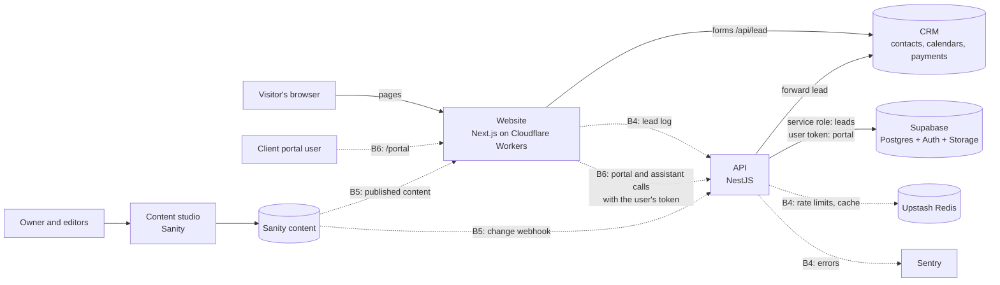

# Techieficial architecture (draft)

Nov 26, 2026 · Status: draft from B2 and B3. Everything below the website runs locally only; no
cloud accounts exist yet. B4 and B5 make it live.

## System

Solid lines exist in code today; dotted lines are wired up in the step named.

## Parts

| Part | Folder | Today | Goes live in |
| --- | --- | --- | --- |
| Website | repo root | Live, copy in `content/` | (session A) |
| Content studio | `studio/` | Builds and tests locally, all schemas done | B5 |
| Database | `supabase/` | Migration and seed, RLS tested on PGlite | B4 |
| API | `api/` | Runs locally in memory, all tests pass | B4 |

## Database tables

| Table | Holds | Row-level security |
| --- | --- | --- |
| `clients` | The businesses we build for | Members read their own; staff read and write |
| `profiles` | Portal users, role `client`, `staff` or `admin` | Read own; staff read all; only admins change roles |
| `client_projects` | Builds, status kickoff, build, review, live, operate | Clients read their business's; staff write |
| `project_files` | Storage paths of project files | Clients read their business's; staff write |
| `support_tickets` | Portal tickets | Clients read and open their business's; staff write |
| `leads` | Every website lead (CRM payload keys + sync status) | Insert by the API's service role only; staff read; anon nothing |
| `audit_logs` | Who changed what, before and after | Written by triggers; admins read; no update or delete for anyone |

Details and checks: `supabase/README.md`.

## API endpoints

| Method | Path | Auth | Limit per IP |
| --- | --- | --- | --- |
| GET | `/health` | none | 120 a minute |
| POST | `/v1/leads` | none | 8 per 10 minutes |
| GET | `/v1/portal/projects` | Supabase token | 60 a minute |
| GET | `/v1/portal/projects/:id` | Supabase token | 60 a minute |
| POST | `/v1/portal/tickets` | Supabase token | 60 a minute |
| POST | `/v1/assistant/chat` | none (rate limited) | 20 a minute; answers 501 until B6 |

Docs at `/docs`; a copy is in `api/openapi.json`. Errors: `{ statusCode, error, message, fields?, requestId }`.

## Settings

API (`api/.env.example`): `PORT`, `CORS_ORIGINS`, `LOG_LEVEL`, `SUPABASE_URL`, `SUPABASE_ANON_KEY`,
`SUPABASE_SERVICE_ROLE_KEY` (secret), `SUPABASE_JWT_SECRET` (secret), `CRM_WEBHOOK_URL` (secret),
`UPSTASH_REDIS_REST_URL`, `UPSTASH_REDIS_REST_TOKEN` (secret), `SENTRY_DSN`.

Studio (`studio/.env.example`): `SANITY_STUDIO_PROJECT_ID`, `SANITY_STUDIO_DATASET`, `SANITY_STUDIO_APP_ID`.
These are public by design; no Sanity token is ever bundled.

The website's own settings stay in the root `.env.example` (session A).

## Security in short

- Row-level security on every table; the service role key lives only on the API host.
- Portal queries run with the signed-in user's token, so the database, not the API, decides what a client sees.
- Every route is rate limited; validation rejects unknown fields; bodies are never logged.
- helmet headers, CORS limited to the site, JSON body limit 100 KB.
- Seed data is fictional test records only.

## What remains

**B4 (needs M3 accounts):**
- Create the Supabase project, `supabase db push`, repeat the RLS checks on the real stack, create the `project-files` bucket and its policies, create the first admin.
- Pick the API host (one small always-on Node service, close to the Supabase region) and set the secrets there.
- Upstash: Redis-backed `ThrottlerStorage` in `api/src/rate-limit/rate-limit.module.ts`, so limits hold across instances; session cache.
- Sentry in the API error filter; uptime monitor on `/health`.
- Decide whether the site's `/api/lead` also writes to the lead log through the API (keeps the current CRM path as the fallback), and add a retry job for leads with `crm_sync_status = 'failed'`.
- If the Supabase project uses asymmetric signing keys, switch token checks to the project's JWKS URL.

**B5:** connect the Studio to a Sanity project, roles, publish rules by role, change webhook into `audit_logs`, move `content/` into Sanity without changing live text, `/studio` redirect or embed.

**B6:** client portal pages on the site and the AI assistant behind `/v1/assistant/chat`.
